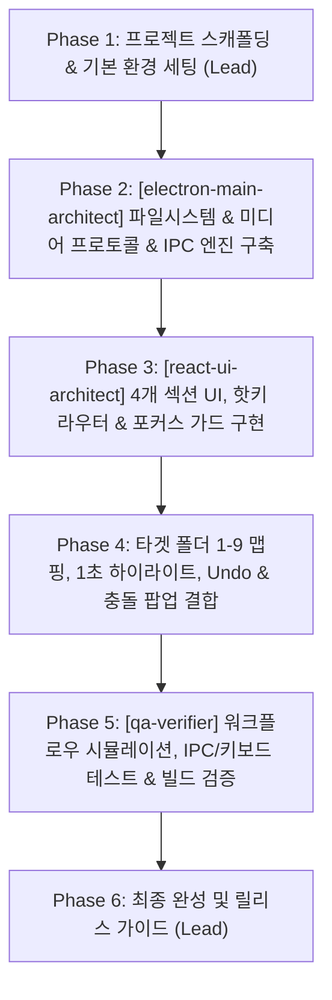

# Multi-Agent Architecture & Execution Harness

이 문서는 **Fast Media Organizer** 개발을 위한 전담 멀티에이전트 팀과 하네스(실행 환경 및 오케스트레이션 파이프라인)의 설계 및 운영 계획입니다.

---

## 1. 멀티에이전트 팀 구성 (Specialist Agents)

| 에이전트 명                   | 역할 (Role)                              | 핵심 책임 영역                                                                                                                                                                                                                                                                                                                                                                                                                             |
| :---------------------------- | :--------------------------------------- | :----------------------------------------------------------------------------------------------------------------------------------------------------------------------------------------------------------------------------------------------------------------------------------------------------------------------------------------------------------------------------------------------------------------------------------------- |
| **Orchestrator** (Lead)       | 프로젝트 총괄 및 조율                    | 사용자 요구사항 정합성 검증, 에이전트 간 작업 분배, 단계별 게이트 통과 관리, 통합 피드백                                                                                                                                                                                                                                                                                                                                                   |
| **`electron-main-architect`** | Electron 메인 프로세스 & 시스템 IPC 전문 | • Windows 파일 시스템 API (드라이브 열거, 디렉터리 트리 순회, 파일 메타데이터)<br>• 대용량 비디오 스트리밍을 위한 커스텀 프로토콜 (`media://` Range request)<br>• 파일 이동/복사 엔진, 충돌 전략(덮어쓰기/건너뛰기/자동수정), Windows 파일 락 방지<br>• 실행 취소(Undo) 히스토리 엔진 및 영구 설정 저장(`config.json`)                                                                                                                     |
| **`react-ui-architect`**      | 렌더러 UI & 키보드 워크플로우 전문       | • 4분할 리사이저블 레이아웃 (트리 / 타겟 1-9 / 탭 폴더 내용 / 미리보기)<br>• 타겟 폴더 1초 하이라이트 애니메이션 및 슬롯 드래그앤드롭<br>• Q-Dir 스타일 멀티탭, 상세 보기 / 썸네일 보기(크기 조절 슬라이더)<br>• 커스텀 비디오 플레이어(타임라인 탐색, 볼륨/Mute 동기화, 자동/수동 재생)<br>• **전역 키보드 라우터 & 포커스 가드(Focus Guard)**: 타임라인/볼륨 클릭 후에도 방향키·핫키 즉시 동작 보장<br>• 설정 모달 & 충돌 해결 팝업 구현 |
| **`qa-verifier`**             | 품질 보증 & 워크플로우 검증 전문         | • TypeScript 타입 검사, 린트 및 번들 빌드 검증<br>• IPC 동작 및 파일 이동/복사/Undo 엣지 케이스 단위 테스트 검증<br>• 키보드 이벤트 파이프라인 시뮬레이션 및 포커스 뺏김 현상 검증<br>• 최종 릴리스 빌드 패키징 무결성 검증                                                                                                                                                                                                                |

---

## 2. 실행 하네스 (Execution Harness) 구조

```
c:\cowork\organizer\
├── package.json
├── electron.vite.config.ts
├── tsconfig.json
├── src/
│   ├── main/                  <-- [electron-main-architect] 전담 영역
│   │   ├── index.ts           (윈도우 라이프사이클)
│   │   ├── protocol.ts        (media:// 스트리밍 프로토콜)
│   │   ├── fs-service.ts      (드라이브/트리/파일목록/이동/복사/Undo)
│   │   ├── store.ts           (설정 영구 저장 관리)
│   │   └── ipc-handlers.ts    (타입세이프 IPC 라우팅)
│   │
│   ├── preload/               <-- IPC Contract 공통 인터페이스
│   │   ├── index.ts           (contextBridge API 노출)
│   │   └── index.d.ts         (전역 Window 타입 정의)
│   │
│   └── renderer/              <-- [react-ui-architect] 전담 영역
│       ├── index.html
│       ├── src/
│       │   ├── App.tsx        (메인 4분할 레이아웃 및 Focus Guard)
│       │   ├── components/
│       │   │   ├── Layout/    (Resizable Split Panes, Top Toolbar)
│       │   │   ├── Tree/      (1. 폴더 트리 섹션)
│       │   │   ├── Targets/   (2. 타겟 폴더 1-9 슬롯 & 하이라이트)
│       │   │   ├── Explorer/  (3. 폴더 내용 탭, 상세테이블, 썸네일그리드)
│       │   │   ├── Preview/   (4. 사진 뷰어, 커스텀 비디오 플레이어/타임라인)
│       │   │   ├── Modals/    (설정 모달, 파일 충돌 해결 팝업)
│       │   │   └── Common/    (토스트, 슬라이더, 툴팁)
│       │   ├── hooks/         (useKeyboardRouter, useVideoControls)
│       │   ├── store/         (useExplorerStore, useSettingsStore, useUndoStore)
│       │   └── types/
│
└── tests/ / scripts/          <-- [qa-verifier] 전담 영역
    ├── fs-ops.test.ts         (파일 이동/복사/이름충돌/Undo 검증)
    ├── hotkey-router.test.ts  (단축키 및 포커스 라우팅 검증)
    └── verify-build.js        (빌드 및 실행 무결성 체크)
```

---

## 3. 워크플로우 오케스트레이션 단계



1. **Gate 1**: 프로젝트 뼈대 생성 및 TypeScript + Tailwind 설정 완료
2. **Gate 2**: 메인 IPC(드라이브 열거, 파일 리스트, 미디어 프로토콜, 이동/복사/충돌/Undo) 동작 확인
3. **Gate 3**: 4분할 UI 레이아웃, Q-Dir 스타일 탭/그리드, 동영상 타임라인 및 포커스 가드 렌더링 확인
4. **Gate 4**: 단축키(1~9, Space, X/Y/Z 건너뛰기)로 초고속 분류 동작 및 타겟 1초 하이라이트 확인
5. **Gate 5**: QA 에이전트의 전체 빌드 및 워크플로우 검증 통과 후 배포 준비
